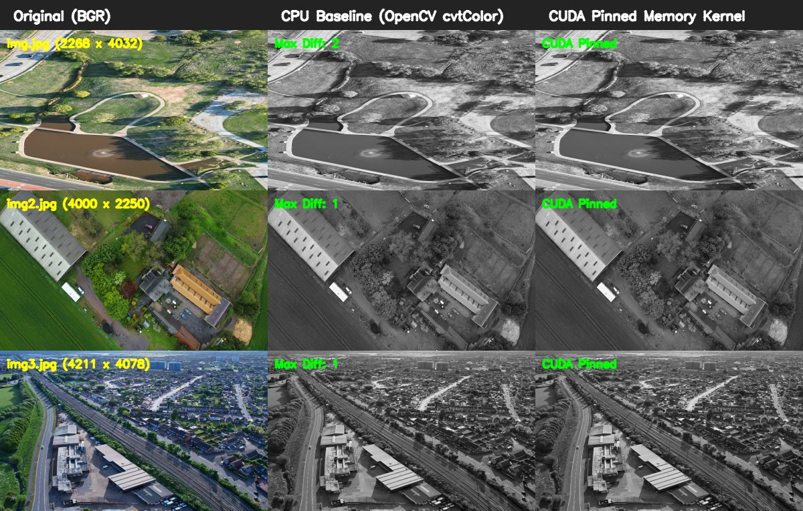

# Drone Image Preprocessing — CUDA & CPU Grayscale Benchmark

## Overview

This repository demonstrates GPU-accelerated preprocessing for high-resolution aerial drone imagery on an **NVIDIA Jetson Orin Nano Super** running JetPack 7.2.1. The project compares CPU OpenCV image grayscale conversion against custom CUDA kernel implementations across memory paradigms (pageable vs. pinned host memory).

---

## Hardware & Environment Specifications

- **Device:** NVIDIA Jetson Orin Nano Super
- **Architecture:** ARM64 (aarch64)
- **Memory:** 8 GB Unified LPDDR5
- **JetPack:** 7.2.1 (L4T r39.2.1)
- **CUDA Toolkit:** 13.2
- **Compiler:** NVCC 13.2 (`/usr/local/cuda/bin/nvcc`)
- **OpenCV:** 4.8.0

---

## Dataset

All input images reside in `data/`:

| Image | Resolution | Total Pixels | Raw Size (BGR) |
|---|---|---:|---:|
| `img.jpg` | 2268 x 4032 | 9,144,576 | 26.16 MB |
| `img2.jpg` | 4000 x 2250 | 9,000,000 | 25.75 MB |
| `img3.jpg` | 4211 x 4078 | 17,172,458 | 49.13 MB |

---

## Project Structure

```text
drone-preprocessing/
├── data/                               # Original drone images (never modified)
│   ├── img.jpg
│   ├── img2.jpg
│   └── img3.jpg
├── results/                            # Generated outputs and benchmark logs
│   ├── benchmark_notes.md              # Detailed experiment log (Experiments 001 - 006)
│   ├── benchmark_results.csv           # Structured benchmark metrics
│   ├── img_cpu_gray.jpg                # CPU OpenCV output
│   ├── img2_cpu_gray.jpg
│   ├── img3_cpu_gray.jpg
│   ├── img2_cuda_gray.jpg              # Kernel-only test output
│   ├── img2_cuda_e2e_gray.jpg          # Pageable memory E2E output
│   ├── img_cuda_pinned_gray.jpg        # Pinned memory CUDA output (single-pass)
│   ├── img2_cuda_pinned_gray.jpg       # Pinned memory CUDA output (benchmarked)
│   ├── img3_cuda_pinned_gray.jpg       # Pinned memory CUDA output (single-pass)
│   └── visual_comparison.jpg           # Grid showing Original, CPU Gray, and CUDA Gray
├── src/
│   ├── inspect_images.py               # Inspects dimensions and memory footprint
│   ├── grayscale_cpu.py                # CPU OpenCV baseline benchmark
│   ├── grayscale_cuda.cu               # Custom CUDA kernel (kernel-only benchmark)
│   ├── grayscale_cuda_e2e.cu           # CUDA end-to-end benchmark (pageable memory)
│   ├── grayscale_cuda_pinned.cu        # CUDA end-to-end pinned memory implementation
│   └── create_comparison.py            # Numerical validator and visual grid generator
└── README.md
```

---

## Implementations

1. **CPU Baseline (`src/grayscale_cpu.py`)**  
   Uses OpenCV's optimized CPU routine (`cv2.cvtColor(image, cv2.COLOR_BGR2GRAY)`).
2. **Custom CUDA Kernel (`src/grayscale_cuda.cu`)**  
   1D grid with 256 threads per block. Each thread processes one RGB pixel:  
   `gray = roundf(0.114f * B + 0.587f * G + 0.299f * R)`  
   Measures GPU kernel execution time only (excluding host-device transfers).
3. **CUDA Pageable End-to-End (`src/grayscale_cuda_e2e.cu`)**  
   Measures complete pipeline: Host-to-Device transfer (`cudaMemcpy`), kernel execution, and Device-to-Host transfer using standard pageable memory.
4. **CUDA Pinned Memory End-to-End (`src/grayscale_cuda_pinned.cu`)**  
   Uses page-locked host memory (`cudaHostAlloc`) to accelerate PCIe/bus transfers. Employs C++ RAII smart pointers for leak-free resource deallocation. Supports batch processing of all input images.

---

## Measured Benchmark Results

> [!NOTE]
> Multi-iteration benchmarks (100 iterations after warm-up) were systematically executed for `img2.jpg` (4000 x 2250, 9 MP) across all pipeline stages.  
> Outputs for `img.jpg` and `img3.jpg` in CUDA were generated via a single conversion pass for numerical verification and visual output generation (no multi-iteration benchmark metrics are claimed for them).

### 1. CPU OpenCV Baseline (100 iterations)

| Image | Resolution | Average Latency | Throughput |
|---|---|---:|---:|
| `img2.jpg` | 4000 x 2250 | 2.0759 ms | 481.72 FPS |
| `img.jpg` | 2268 x 4032 | 2.0966 ms | 476.95 FPS |
| `img3.jpg` | 4211 x 4078 | 3.6471 ms | 274.19 FPS |

### 2. CUDA Pipeline Breakdown on `img2.jpg` (100 iterations)

| Implementation | Stage | Average Latency | Throughput |
|---|---|---:|---:|
| **Custom CUDA (Kernel-only)** | GPU Kernel | 1.19187 ms | 839.02 FPS |
| **CUDA Pageable Memory** | Host-to-Device (H2D) | 4.13267 ms | 241.97 FPS |
| | GPU Kernel (host-synced) | 1.55612 ms | 642.63 FPS |
| | Device-to-Host (D2H) | 1.55061 ms | 644.91 FPS |
| | **Total End-to-End** | **7.24153 ms** | **138.09 FPS** |
| **CUDA Pinned Memory** | Host-to-Device (H2D) | 1.16549 ms | 857.27 FPS |
| | GPU Kernel (host-synced) | 1.55175 ms | 644.43 FPS |
| | Device-to-Host (D2H) | 0.42269 ms | 2365.80 FPS |
| | **Total End-to-End** | **3.14117 ms** | **318.35 FPS** |

### Key Benchmark Insights
- **Kernel vs. CPU:** The isolated CUDA kernel (1.19 ms) achieves **1.74x speedup** over CPU OpenCV (2.08 ms).
- **Pageable Transfer Bottleneck:** Under standard pageable memory, memory copy overhead (5.68 ms) dominates the pipeline, resulting in 7.24 ms total latency (slower than CPU).
- **Pinned Memory Optimization:** Using pinned memory reduces transfer overhead from 5.68 ms down to 1.59 ms, yielding a **2.31x end-to-end speedup** over the pageable CUDA baseline (3.14 ms vs 7.24 ms).

---

## Output Validation & Numerical Consistency

All CUDA grayscale outputs were numerically validated against the CPU OpenCV reference using `cv2.absdiff()`:

| Image | Max Absolute Diff | Mean Absolute Diff | Exact Matches (`diff == 0`) | Within Tolerance (`diff <= 2`) | Status |
|---|---:|---:|---:|---:|:---:|
| `img.jpg` | 2 | 0.000046 | 99.9954% | 100.0000% | **PASS** |
| `img2.jpg` | 1 | 0.000007 | 99.9993% | 100.0000% | **PASS** |
| `img3.jpg` | 1 | 0.000016 | 99.9984% | 100.0000% | **PASS** |

Over 99.99% of pixels are identical between CPU and CUDA implementations. Minor differences (≤ 2 intensity levels) stem from integer vs. floating-point rounding arithmetic and JPEG codec quantization.

---

## Visual Comparison

A compact visual comparison grid (`results/visual_comparison.jpg`, 291 KB) displays Original BGR, CPU Grayscale, and Pinned CUDA Grayscale side-by-side for all three images:



---

## Build & Execution Instructions

All commands are executed from the project root directory (`~/jetson-lab/drone-preprocessing`).

### 1. Compile CUDA Implementations
```bash
# Compile pinned memory implementation
/usr/local/cuda/bin/nvcc -O3 src/grayscale_cuda_pinned.cu -o grayscale_cuda_pinned \
  -I/usr/include/opencv4 -lopencv_core -lopencv_imgcodecs -lopencv_imgproc
```

### 2. Run Processing
```bash
# Process dataset (preserves existing outputs, converts missing images)
./grayscale_cuda_pinned

# Or process a single image:
./grayscale_cuda_pinned <input_image_path> <output_image_path>
```

### 3. Verify & Generate Visual Comparison Grid
```bash
python3 src/create_comparison.py
```

